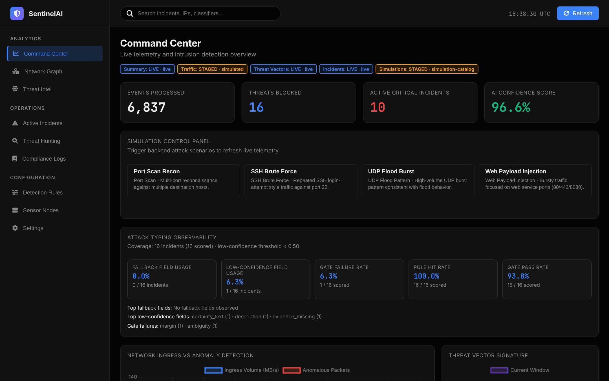
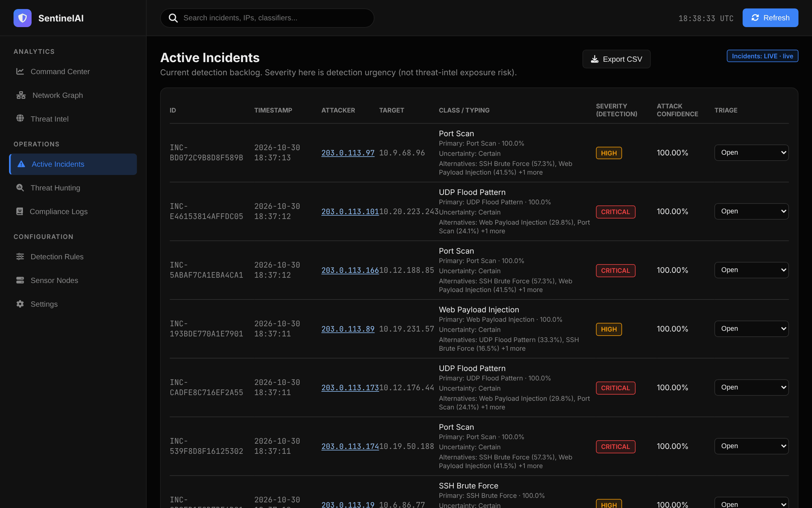
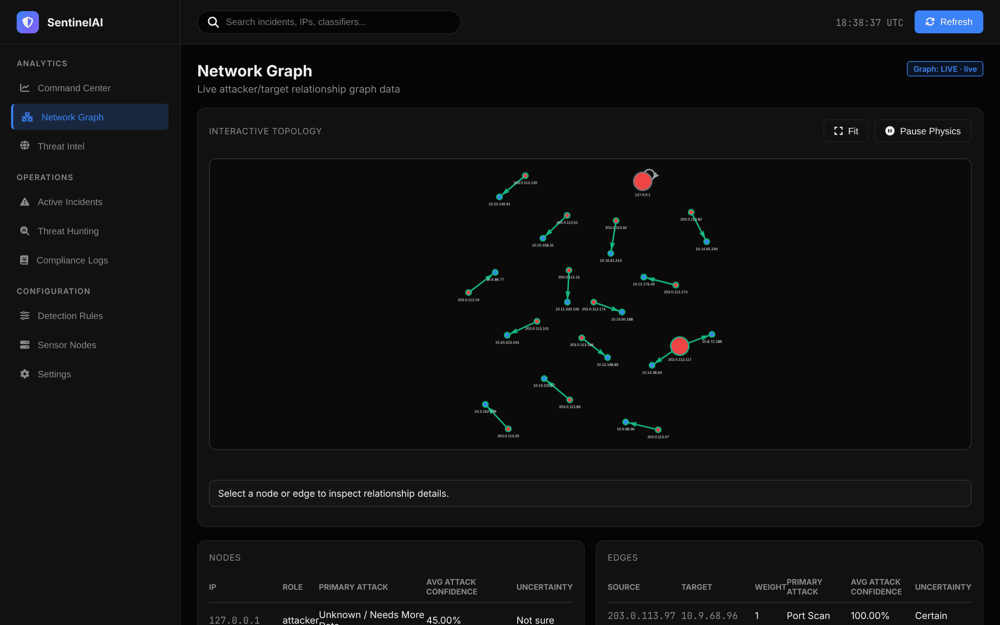
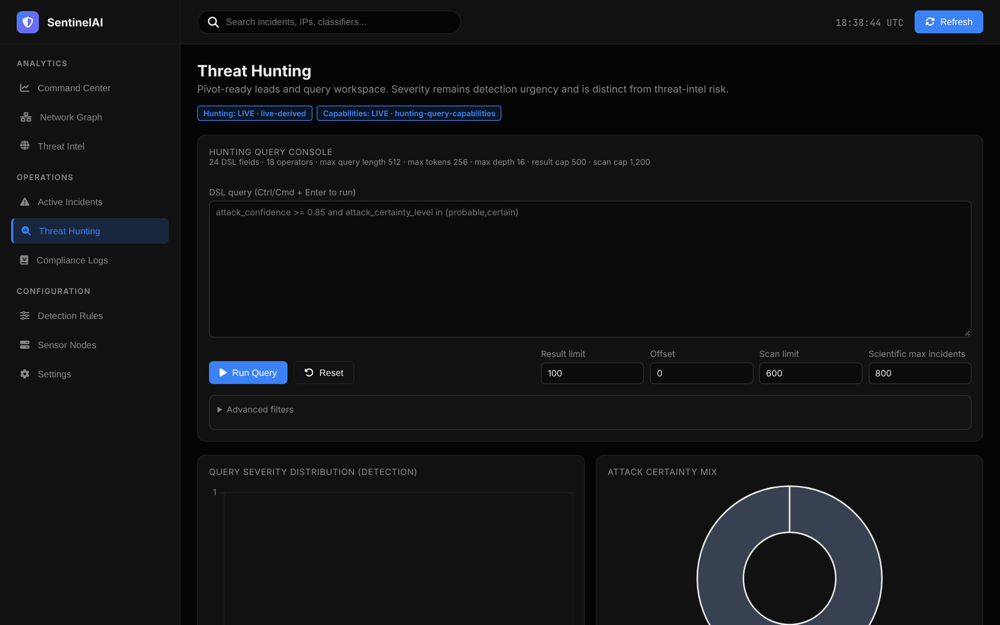
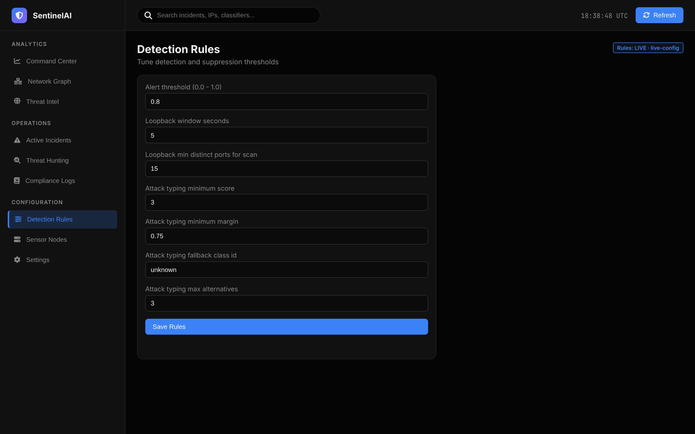
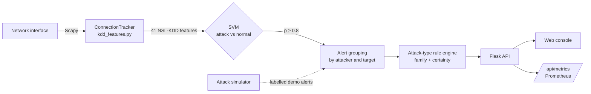

<div align="center">

# SentinelAI

A network intrusion detection system that captures live traffic, rebuilds NSL-KDD connection features,<br />
scores every connection with an SVM and turns detections into triaged incidents in a SOC-style web console.

<br />


<sub>End-of-semester project · Cybersecurity · Machine learning · 2025/2026</sub>

[Screenshots](#screenshots) &nbsp;·&nbsp; [How it works](#how-it-works) &nbsp;·&nbsp; [Results](#results) &nbsp;·&nbsp; [Getting started](#getting-started) &nbsp;·&nbsp; [API](#api)

<br />



</div>

## Overview

SentinelAI sniffs packets with Scapy, groups them into bidirectional connections and computes the 41 NSL-KDD features for each one: service, TCP connection state, bytes in each direction, and the traffic statistics over the last 2 seconds and the last 100 connections. An RBF SVM trained on NSL-KDD decides whether the connection is an attack. Detections from the same attacker are grouped into incidents, then a deterministic rule engine names the attack family (port scan, SSH brute force, web payload injection, UDP flood) and explains how sure it is.

Everything is exposed through a Flask API and a single-page console: command center, incidents with triage, an attacker and target graph, threat intelligence from Shodan, a threat-hunting query language, rule tuning and compliance logs.

## Screenshots

<sub>Captured from a local run: a real TCP connect scan against localhost, plus the built-in attack scenarios.</sub>

<table>
  <tr>
    <td width="50%"><p align="center"><b>Incidents with attack family, certainty and triage state</b></p></td>
    <td width="50%"><p align="center"><b>Attacker and target graph</b></p></td>
  </tr>
  <tr>
    <td><p align="center"><b>Threat-hunting query console</b></p></td>
    <td><p align="center"><b>Live rule and threshold tuning</b></p></td>
  </tr>
</table>

## How it works



| Stage | Code | What happens |
|---|---|---|
| Capture | `src/monitoring/packet_sniffer.py` | Scapy sniffers on one or more interfaces, background analysis loop every 2 seconds |
| Features | `src/monitoring/kdd_features.py` | Bidirectional connections, KDD service names from ports, connection states (`SF`, `S0`, `REJ`, `RSTO`...) from TCP flags, failed-login markers, 2-second and 100-connection traffic statistics |
| Detection | `RealtimeIDS.score()` | Saved label encoders and scaler, then the SVM's attack probability |
| Incidents | `src/web/runtime_service.py` | Groups detections per attacker and target, keeps triage state, builds the overview, graph and hunting views |
| Attack family | `src/web/attack_type_rules.py`, `config/attack_type_rules.json` | 16 weighted rules over ports, protocols and volumes, with score and margin gates. Certainty is `certain`, `probable` or `not_sure`, with the evidence used and missing |
| Hunting | `src/web/query_dsl.py`, `scientific_methods.py` | Safe query language (`attack_confidence >= 0.85 and attack_certainty_level in (probable,certain)`), z-score outliers, burst detection, entropy and clustering |
| Threat intel | `runtime_service.py` | Optional Shodan lookups for attacker IPs, shown on a map |

The SVM only answers "attack or normal". The attack family comes from the rule engine, which is deterministic and explains its decision, so the console never presents a guess as a certainty.

## Results

Models are trained on **KDDTrain+** and evaluated on **KDDTest+**. The test set contains 17 attack types that never appear in training, which is why every model loses recall there. Scores on a random split of the training file are above 99% and are not a fair measure.

| Model | Accuracy | Precision | Recall | F1 | ROC AUC | Training time |
|---|:---:|:---:|:---:|:---:|:---:|:---:|
| **SVM (RBF, C=100)**, used at runtime | **80.2%** | 97.0% | **67.2%** | **0.794** | 0.847 | 8.4 min |
| Gradient Boosting | 78.7% | 96.7% | 64.8% | 0.776 | 0.966 | 1.8 min |
| Neural network (MLP 128-64-32) | 78.0% | 97.3% | 63.1% | 0.766 | 0.936 | 48 s |
| Random Forest | 76.9% | 96.7% | 61.5% | 0.752 | 0.969 | 11 s |

Precision stays around 97%: when SentinelAI raises an alert it is almost always a real attack. The misses are mostly password-guessing and other content attacks that KDDTest+ adds.

### Live traffic check

`python scripts/simulate_traffic.py` pushes crafted packet streams through the same live code path (no root needed):

| Traffic | Connections | Flagged at p ≥ 0.8 |
|---|:---:|:---:|
| Normal web browsing (HTTP and HTTPS sessions) | 60 | 1 |
| Normal DNS lookups | 30 | 0 |
| SYN port scan, closed ports answer with RST | 299 | 256 |
| SYN flood from spoofed sources | 400 | 400 |
| FTP password guessing | 20 | 0 |

### What changed from the first version

The first live sniffer passed raw values the model had never seen: the destination port number where the model expects a service name such as `http` or `private`, the packet count as the TCP flag, no bytes from the server, and fixed traffic statistics. Unknown values silently fell back to the first class of each encoder, so ordinary HTTPS traffic was flagged at 99 to 100%. The feature extractor was rewritten to follow the KDD definitions, the training pipeline was restored and the models retrained, and the web server, which returned HTTP 500 on every request because of a broken metrics hook, was fixed.

## Getting started

**Requirements**: Python 3.10+, root or administrator rights for packet capture, [Npcap](https://npcap.com/) on Windows.

```bash
pip install -r requirements.txt
sudo python src/cli.py web --port 8050      # web console + live capture
```

Open http://127.0.0.1:8050, then use the **Simulation control panel** to trigger the demo scenarios, or scan the machine from another host.

Other commands:

```bash
sudo python src/cli.py monitor --interface eth0     # capture only, alerts in the terminal and logs/
python src/cli.py web --threshold 0.7 --interface lo
python src/windows_launcher.py                      # small Windows start/stop window with saved settings
```

### Retrain the models

The trained SVM, scaler and encoders are included. To rebuild them from the dataset in `data/raw/`:

```bash
python src/training/preprocess.py
python src/training/train.py                 # SVM only (about 8 minutes)
python src/training/train.py --models all    # plus Random Forest, Gradient Boosting and MLP
```

### Docker (Linux)

```bash
GRAFANA_ADMIN_PASSWORD=choose-one docker compose up --build
```

Runs SentinelAI on the host network with the `NET_RAW` and `NET_ADMIN` capabilities so it sees real traffic, plus Prometheus (port 9090) scraping `/api/metrics` and Grafana (port 3000) with a provisioned SentinelAI dashboard.

### Tests

```bash
pytest
```

Covers the live feature extraction (handshakes, scans, floods, failed logins), every read endpoint of the API, simulations, API-key protection of write endpoints, and the attack-typing regression checks.

## Configuration

`config/ids_config.json` holds the model paths, alert threshold, attack-typing gates (`minimum_score`, `minimum_margin`, fallback class), threat-intel limits, interface, web host and port, and the localhost scan heuristic. Command-line flags override it.

| Environment variable | Effect |
|---|---|
| `API_KEY` | When set, triage, simulation and configuration writes require the `X-API-Key` header |
| `SHODAN_API_KEY` | Enables threat-intel lookups for attacker IPs |

## API

| Method | Endpoint | |
|---|---|---|
| GET | `/api/health`, `/api/metrics` | Health check, Prometheus metrics |
| GET | `/api/overview/summary`, `/api/overview/charts` | Command center data |
| GET | `/api/incidents`, `/api/incidents/export?format=csv` | Incidents with the canonical `attack_detail` object |
| PUT | `/api/incidents/<id>/triage` | `open`, `in_review`, `contained`, `dismissed` |
| GET, POST | `/api/simulation/scenarios`, `/api/simulation/trigger` | Demo scenarios (labelled as simulated) |
| GET | `/api/network/graph`, `/api/threat-map`, `/api/threat-intel` | Graph, map and Shodan data |
| GET, POST | `/api/hunting`, `/api/hunting/query`, `/api/hunting/capabilities` | Threat-hunting queries |
| GET, PUT | `/api/config/rules`, `/api/config/settings`, GET `/api/config/sensors` | Live configuration |

## Project structure

```
network-intrusion-detection-ml/
├── src/
│   ├── cli.py                 # monitor / web commands
│   ├── monitoring/            # packet capture, live NSL-KDD features, scoring
│   ├── web/                   # Flask API, runtime service, rule engine, hunting DSL, simulator, static console
│   ├── training/              # preprocessing and model training
│   ├── windows_launcher.py    # Tkinter start/stop launcher
│   └── attack_typing_metadata_regression_check.py
├── config/                    # runtime config and attack-type rules (+ JSON schema)
├── models/                    # svm_model.pkl, model_results.json
├── data/raw/                  # NSL-KDD KDDTrain+ and KDDTest+
├── data/processed/            # scaler and label encoders
├── monitoring/                # Prometheus and Grafana provisioning
├── scripts/simulate_traffic.py
├── tests/
├── Dockerfile, docker-compose.yml
└── docs/screenshots/
```

## Limitations

- NSL-KDD dates from 1999 traffic. The model knows its attack styles (scans, floods, some password guessing) and will miss modern application-layer attacks.
- Content features that need full protocol parsing (root shells, file creations, compromised conditions) are left at 0 in live capture.
- Encrypted traffic is only judged on its connection pattern.
- The simulation panel injects labelled synthetic alerts for demos. They do not go through packet capture.

## Dataset

[NSL-KDD](https://www.unb.ca/cic/datasets/nsl.html), Canadian Institute for Cybersecurity, University of New Brunswick (Tavallaee et al., 2009). 125,973 training and 22,544 test connections.

---

<div align="center"><sub>Part of <a href="https://github.com/creepout777">Yassine Aitaouicha's projects</a></sub></div>
